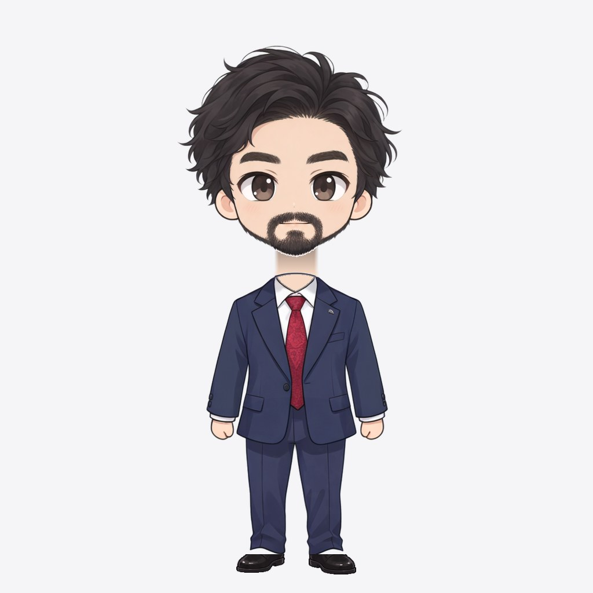

# 峰哥 Live2D 模型

> 一张 AI 立绘 → 一个能眨眼、能呼吸、能说话、能跟着鼠标转头的**真 Live2D 模型**。
> 不是纸片人差分，是带 `.moc3` 的 Cubism 3 模型。

| 规格 | 值 |
|---|---|
| 格式 | `.moc3` + `model3.json` + `physics3.json` + `cdi3.json` |
| 部件 | 26 个 |
| 参数 | 34 个 |
| 动作 | 24 组 |
| 贴图 | 26 张 |
| 体积 | 7.4 MB（54 个文件） |
| 模型目录 | `web/vendor/live2d/models/fengge/` |
| 素材 | `web/assets/fengge-ref.png`（1024×1536 RGBA） |



## 1. 素材

`web/assets/fengge-ref.png` —— 用户提供的 AI 生成立绘，1024×1536，带 alpha 通道，
正面、平视、四肢分开（A-pose），这是能自动绑骨的前提条件。

确定性要求：

- **正面、无透视**：侧面或动态姿势分不出左右对称的肢体
- **四肢离开躯干**：贴在一起时分层算法会把手臂并进身体
- **纯色/透明背景**：背景会被当成「背景层」拆出来
- **≥1024 长边**：分辨率太低时五官层会糊，眼睛和睫毛分不开

## 2. 工具链

| 环节 | 工具 | 说明 |
|---|---|---|
| 语义分层 | [See-Through](https://github.com/shitagaki-lab/see-through)（LayerDiff3D + Marigold，NF4 量化） | 单图 → 20+ 个语义图层 + 深度图 |
| 自动绑骨 | [image2live2d](https://github.com/Wzhang3912/image2live2d) | 纯 Python 直接写 `.moc3`，含 mesh / 变形器 / 物理 / 动作 |
| 外壳 | [live2d-ai-generator](https://github.com/naiyouj/live2d-ai-generator) | 本地 Web 控制台，五步可视化，8GB 显存分档 |
| 渲染 | pixi.js 6.5 + live2dcubismcore + pixi-live2d-display | 浏览器里跑 Cubism 3/4 |

环境（RTX 4060 Laptop 8GB 实测）：

```
torch 2.8.0+cu128 / torchvision 0.23.0+cu128
diffusers 0.37.0 / transformers 5.0.0 / tokenizers 0.22.2 / accelerate 1.13.0
pycocotools（依赖清单漏了）
分层权重 5.3 GB（HF_HOME 指到 D 盘）
```

## 3. 五步流程

```
① 立绘 PNG → ② 预处理 → ③ AI 分层 → ④ AI 绑骨 → ⑤ 预览导出
```

| 步骤 | 做什么 | 实测耗时 |
|---|---|---|
| ① 生图 | 直接用现成立绘（跳过） | — |
| ② 预处理 | 裁到 alpha 包围盒、居中成正方形 | 2 秒 |
| ③ 分层 | See-Through NF4 / 1024 / 30 步，拆出 13 个语义层 | **8 分钟**，显存 7.8/8.2 GB |
| ④ 绑骨 | image2live2d 建 mesh / 变形器 / 物理 / 动作 | 12 秒 |
| ⑤ 导出 | 生成 `.moc3` + 26 张贴图 + 24 组动作 | 8 秒 |

分层拿到的 13 个语义层：

```
neck  handwear  legwear  front hair  ears  face  nose
eyewhite  eyebrow  eyelash  topwear  mouth  irides
```

## 4. 修补：三个「AI 没做对」的地方

自动流水线出来的第一版能用，但有三处必须人工补：

### 4.1 没有脚

`legwear` 只到脚踝。深色皮鞋压在暗背景上，See-Through 直接漏掉了。

**补法**：从原图 `clean.png` 的 `legwear` 底边往下整条切出来，按列投影找左右脚之间的空隙，
拆成 `leg_l` / `leg_r` 两个可绑骨的零件。

### 4.2 没脖子

原画里下巴直接压在衬衫领上，`neck` 层只有 67×60 且被完全盖住——露出高度是**负的**。

只在原地画一块皮肤没用：领口到下巴只有 20px，显示到 186px 画布上只剩 5px。

**补法**：重新构图。

1. 整图缩到 85%（上下腾出 77px，头发也不会被画布顶裁掉）
2. 头不动，身体（西装/手臂/腿/鞋）下移 50px
3. 中间空出的 32px 填梯形皮肤

### 4.3 头挡住了脖子（构造保证）

脖子如果是个矩形块，头一转就会从腮帮子旁边露出方角。

**补法**：先算头部剪影（`face ∪ mouth ∪ ears` 的 alpha 并集），**脖子只画在剪影外面**：

```python
head_sil = union(face, mouth, ears)
for x, y in neck_pixels:
    if head_sil.getpixel((x, y)): continue   # 被头挡住的地方不画
```

这样脖子的上边缘天然跟下巴曲线重合，不会出现方角或缝。

### 4.4 其它修正

| 问题 | 修法 |
|---|---|
| 刘海被脸盖住 | 把 `front hair` 的 draw order 提到 `face` 之上 |
| 独立 `neck` 零件显示不出来 | `image2live2d` 的 `normalize_neck_zorder()` 会把脖子压到衣服后面；改成把皮肤涂进 `topwear` |
| 转头时下巴和脖子分家 | 前端把 `updateFocus()` 的 focus 缩到 0.4，实际只转 ±12° |

## 5. 参数与动作

### 关键参数

| 参数 | 范围 | 作用 |
|---|---|---|
| `ParamAngleX/Y/Z` | -30..30 | 头部左右/上下/倾斜 |
| `ParamBodyAngleX` | -10..10 | 身体摆动 |
| `ParamEyeLOpen/ROpen` | 0..1 | 眨眼 |
| `ParamEyeBallX/Y` | -1..1 | 眼球转动 |
| `ParamMouthOpenY` | 0..1 | 说话口型 |
| `ParamMouthForm` | -1..1 | 嘴型（笑/撇嘴） |
| `ParamBrowLY/RY` | -1..1 | 眉毛高度 |
| `ParamBreath` | 0..1 | 呼吸起伏 |
| `ParamArmLA/RA` | -1..1 | 手臂 |
| `ParamHairFront/Back` | -1..1 | 头发物理（由 `physics3.json` 驱动） |

### 24 组动作

```
Idle  Talk  Blink  Smile  Smirk  Angry  Sad  Surprise  Shy  Cheek
Look  Brows  Brow_form  Head_yaw  Head_pitch  Head_roll  Head_shake
Body_sway  Body_bow  Arms_raise  Arms_swing  Legs_swing  Legs_sway  Sweep
```

前端的行为：

- 待机自动循环 `Idle` + 眨眼 + 呼吸
- 鼠标在画面上移动 → 头部跟随（±12°）
- 提问时播 `Talk`，答完回 `Idle`
- 答对播 `Smile`，只沾边播 `Shy`，没聊过播 `Sad`（FORCE 优先级，不会被 Idle 盖掉）

## 6. 在浏览器里用它

```js
// 1. 三个库按顺序加载
await load("vendor/live2d/cubism/pixi.min.js");
await load("vendor/live2d/cubism/live2dcubismcore.min.js");
await load("vendor/live2d/cubism/pixi-live2d-display.min.js");

// 2. 建 PIXI 应用（一定要 sharedTicker）
const app = new PIXI.Application({
  backgroundAlpha: 0, width: 170, height: 196, sharedTicker: true
});
const model = await PIXI.live2d.Live2DModel.from(
  "vendor/live2d/models/fengge/fengge.model3.json", { autoInteract: true }
);
app.stage.addChild(model);
model.anchor.set(0.5, 1);
model.scale.set(0.17);
model.position.set(85, 196);

// 3. 自己驱动（单位是毫秒！）
model.autoUpdate = false;
app.ticker.add(() => model.update(app.ticker.deltaMS));
```

### 三个必须知道的坑

| 坑 | 现象 | 解法 |
|---|---|---|
| 传秒不传毫秒 | 模型完全静止 | `update()` 收毫秒，内部才 `/1000` |
| `autoUpdate` 挂 `Ticker.shared` | 和 `app.ticker` 不同步 | 自己驱动，或 `sharedTicker: true` |
| 用了全量 `index.min.js` | 报 `Could not find Cubism 2 runtime`，`PIXI.live2d` 里只剩 `config` | 换 `dist/cubism4.min.js` |

## 7. 已知限制

- **脸是平板**：只有一张正面脸，没有侧面/后脑勺。转大角度会看出是纸片 → 所以限制 ±12°
- **更加精细的表情做不到**：眉毛、眼皮都是整层位移，不是逐点网格
- **嘴被胡子挡住**：`ParamMouthOpenY` 绑定是通的（手动置 1 会改变 2246 px），但口腔在胡子后面
- **抬头到极限**脖子偏长（脖子是往下垫出来的）

要彻底解决这些问题，需要画师补侧面/后脑勺图层，再进 Cubism Editor 手工调网格。

## 8. 复现

```powershell
# 1. 修补 PSD（加脖子、补鞋、调层序）
python tools\build_live2d_psd.py
#    → output: live2d-build/fix-out/layers_fixed.psd

# 2. 绑骨 + 导出 moc3
cd live2d-build\live2d-ai-generator-main\tools\image2live2d
$env:PYTHONPATH="$PWD\src"
..\..\.venv\Scripts\python.exe -m image2live2d `
  --psd ..\..\..\fix-out\layers_fixed.psd `
  --work-dir ..\..\..\fix-out\layers `
  -o ..\..\..\fix-out\fengge.inp `
  --name fengge --live2d ..\..\..\fix-out\live2d

# 3. 拷进站点
Copy-Item ..\..\..\fix-out\live2d\* D:\fengge-rag\web\vendor\live2d\models\fengge\ -Recurse -Force
```

`tools/build_live2d_psd.py` 顶部三个数字是全部旋钮：

```python
SCALE = 0.85      # 整体缩放（腾出脖子空间）
HEAD_UP = 0       # 正数=头上移，负数=头下移
BODY_DOWN = 50    # 身体下移（决定脖子露出多少）
```

改动后重新跑 1+2 就行，约 20 秒。

## 9. 许可

| 组件 | 许可 |
|---|---|
| Live2D Cubism Core / SDK | Live2D 专有许可，小规模事业者免费 |
| pixi.js | MIT |
| pixi-live2d-display | MIT |
| See-Through | 研究用途 |
| image2live2d | Apache-2.0 |
| 峰哥形象 | 真人二创，仅个人研究使用；**肖像权与版权是两件事**，公开传播前请自行确认 |
